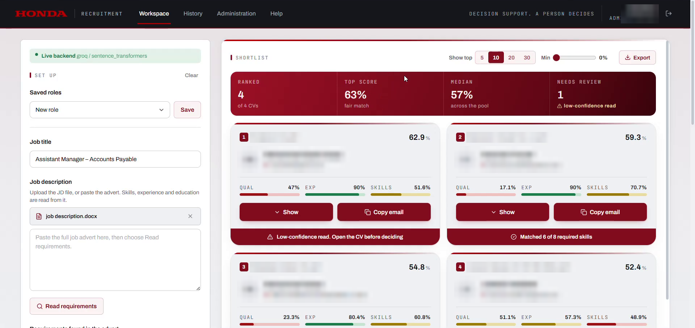
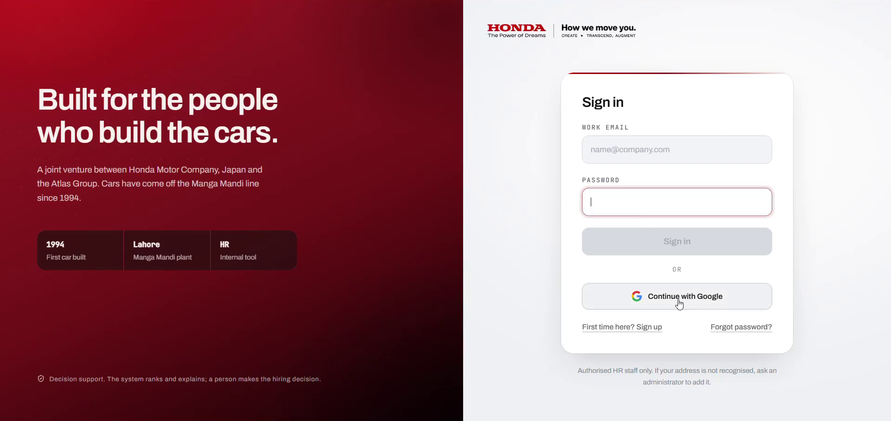
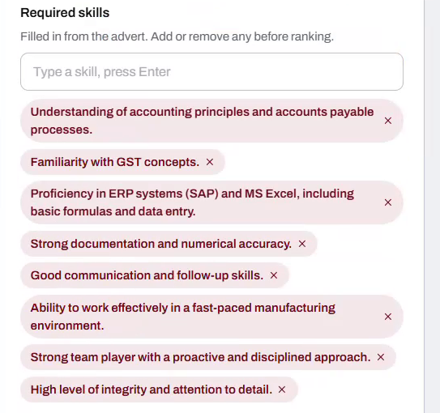

# AI CV Ranking System

An AI-assisted shortlisting tool that reads a batch of CVs, scores each one against a job description, and explains every score in plain words.

Built for Honda Atlas Cars Pakistan and deployed in production, where the HR team uses it to screen real applicants.

> **Decision support, not decision making.** The system ranks and explains. A person makes the hiring decision.


<sub>Candidate names and contact details are blurred.</sub>

---

## Table of contents

- [The problem](#the-problem)
- [What it does](#what-it-does)
- [Screenshots](#screenshots)
- [How scoring works](#how-scoring-works)
- [Architecture](#architecture)
- [Tech stack](#tech-stack)
- [Project structure](#project-structure)
- [Getting started](#getting-started)
- [Testing and evaluation](#testing-and-evaluation)
- [Privacy and responsible use](#privacy-and-responsible-use)
- [Limitations and next steps](#limitations-and-next-steps)

---

## The problem

When a role opens, every CV is opened, read and judged by hand, one at a time. The number of applicants keeps growing, but the hours in a hiring week don't. By the time a recruiter reaches the last CV, it can't get the same attention as the first. Months later, nothing records why a candidate was set aside.

## What it does

- **Reads the job description** (upload a `.docx` or paste the advert) and pulls out the required qualification, experience and skills. HR can edit any of them before ranking.
- **Reads every CV in one pass.** Upload PDF or Word files, up to 100 at once.
- **Scores each candidate the same way**, on the same three factors with equal weight.
- **Explains each score:** which required skills matched, which didn't, and how experience and qualification compare.
- **Flags low-confidence reads**, for example a scanned or badly formatted CV, so a person opens it before deciding.
- **Keeps a record.** Past runs can be reopened later from History, and roles can be saved and reused.
- **Exports the shortlist** to a spreadsheet for HR.
- **Controls access** with email, Google or phone sign-in, limited to approved HR staff, plus an admin panel for managing users.

## Screenshots

| Sign in | Requirements read from the job description |
|---|---|
|  |  |

**Ranked shortlist:** summary of the pool, per-candidate scores for qualification, experience and skills, and a flag on reads that need a human check.


## How scoring works

Every CV is measured against the same job description on three factors:

| Factor | What it checks |
|---|---|
| **Qualification** | Does the candidate's education match what the advert asks for? |
| **Experience** | Total and relevant years compared with the required range |
| **Skills** | How many of the required skills the CV shows, using semantic matching instead of exact keywords |

The three factors are **weighted equally**, and the final score is shown as a percentage. Skills are matched with sentence embeddings, so "accounts payable processing" can match "AP invoice handling" even when the words differ.

The model can misread a CV, so each result carries a confidence signal. Low-confidence results are marked **"Open the CV before deciding"** instead of being trusted blindly.

## Architecture

```
            ┌──────────────────────────┐
            │  React + Vite frontend   │   upload JD & CVs, review shortlist
            └────────────┬─────────────┘
                         │ REST API
            ┌────────────▼─────────────┐
            │     Python API (api/)    │   auth, users, rate limits, email
            └────────────┬─────────────┘
                         │
            ┌────────────▼─────────────┐
            │  Ranking pipeline         │
            │  (cv_ranker/)             │
            │                           │
            │  documents → extract →    │   read PDF/DOCX, LLM extracts
            │  matching → scoring       │   structured data, embeddings
            │                           │   match skills, weighted score
            └────────────┬─────────────┘
                         │
         ┌───────────────┼────────────────┐
         ▼               ▼                ▼
     Groq LLM   sentence-transformers   cache + database
```

## Tech stack

| Layer | Tools |
|---|---|
| Frontend | React, TypeScript, Vite, Tailwind CSS |
| Backend | Python REST API |
| AI | Groq LLM for structured extraction, sentence-transformers for semantic skill matching |
| Auth | Firebase (Google and phone sign-in) plus email/password |
| Testing | pytest, plus a small gold-standard evaluation set |
| Deployment | Railway |

## Project structure

```
cv-ranking-system/
├── api/                 # REST API: auth, users, database, mailer, Firebase
├── cv_ranker/           # Core ranking pipeline
│   ├── documents.py     #   read PDF / Word files
│   ├── extract.py       #   LLM extraction of CV and JD details
│   ├── jd_rules.py      #   rules for reading job descriptions
│   ├── embeddings.py    #   sentence-transformer embeddings
│   ├── matching.py      #   skill matching
│   ├── scoring.py       #   weighted scoring
│   ├── pipeline.py      #   ties the steps together (runs CVs in parallel)
│   ├── cache.py         #   avoids re-processing the same file
│   └── prompts/         #   LLM prompt templates
├── frontend/            # React + TypeScript web app
├── tests/               # pytest suite (scoring, auth, pipeline, rate limits…)
├── eval/                # evaluation script + gold-standard sample CVs
├── scripts/             # start scripts and dev utilities
├── docs/                # run guides and screenshots
├── rank_cvs.py          # command-line entry point
├── requirements.txt
└── .env.example         # copy to .env and fill in your keys
```

## Getting started

### Prerequisites
- Python 3.10+
- Node.js (version in `frontend/.nvmrc`)
- A Groq API key

### 1. Backend

```bash
python -m venv .venv
# Windows
.venv\Scripts\activate
# macOS / Linux
source .venv/bin/activate

pip install -r requirements.txt
cp .env.example .env        # then add your keys to .env
```

Start the API:

```bash
# Windows
scripts\start_backend.ps1
# macOS / Linux
bash scripts/start_backend.sh
```

### 2. Frontend

```bash
cd frontend
npm install
cp .env.example .env        # optional: Firebase config for phone sign-in
npm run dev
```

Open the local URL that Vite prints. Full setup details are in [`docs/RUN_GUIDE.md`](docs/RUN_GUIDE.md).

## Testing and evaluation

Run the test suite:

```bash
pytest
```

The tests cover scoring logic, authentication and passwords, sign-in flows, database concurrency, extraction caching, parallel processing and rate limits.

`eval/` holds a small set of hand-labelled sample CVs (`eval/gold/`) and a script that compares the system's output with the expected answers:

```bash
python eval/evaluate.py
```

## Privacy and responsible use

- **No real candidate data is in this repository.** Uploaded CVs, results and databases are git-ignored, and screenshots are blurred.
- **Secrets stay out of the code.** Keys go in `.env`, which is never committed.
- **A human decides.** The tool never rejects anyone on its own. It ranks, explains and flags uncertain reads for review.
- **Explainable results.** Every score shows its reasons, so a decision can be checked later.

## Limitations and next steps

- Scores depend on how well the LLM reads each CV. Scanned or unusually formatted CVs are more likely to be flagged as low confidence.
- The evaluation set is small. A larger labelled set would give a better measure of accuracy.
- Planned: reading candidates' public LinkedIn profiles as an extra signal, and a closer comparison of the system's picks with HR's final decisions.

---

*Built for and used in production at Honda Atlas Cars Pakistan (HR).*
